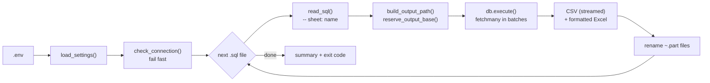

# sql-csv-export

Run `.sql` files against **PostgreSQL** or **Vertica** and save every result as **CSV** and a
**report-ready Excel file**, named and filed the way DBeaver's *Export From Query* does it.
One double-click, or none at all when Windows Task Scheduler runs it every morning.


[](https://www.kaggle.com/datasets/yasserh/walmart-dataset)

## Why this exists

Daily reports used to be pulled from the data warehouse by hand in DBeaver, query by query:
open the `.sql` file → *Export From Query* → CSV → pick this month's folder → name the file
`${scriptFilename} (${timestamp})` → wait → then open it in Excel and format the header.
Every working day, for every query.

This tool does the whole routine in one run and keeps DBeaver's naming, so the files land where
the existing folders and downstream spreadsheets already expect them:

```text
sql/                                   D:\Reports\2026\09. September\
├── walmart_holiday_vs_normal.sql ──►  ├── walmart_holiday_vs_normal (26-09-2026).csv / .xlsx
├── walmart_monthly_sales.sql     ──►  ├── walmart_monthly_sales (26-09-2026).csv / .xlsx
└── walmart_top10_store_2011.sql  ──►  └── walmart_top10_store_2011 (26-09-2026).csv / .xlsx
```

It was built for daily reporting on a **Vertica** data warehouse at work. This public version runs
on **PostgreSQL** with a public dataset, the [Walmart Dataset](https://www.kaggle.com/datasets/yasserh/walmart-dataset) from Kaggle, and the same
code still drives the Vertica setup: the database is just a setting (`DB_TYPE`).

## Features

- **DBeaver-style names and folders**: `${scriptFilename} (${timestamp})`, Java date patterns such as `dd-MM-yyyy`, and folder variables `${yyyy}`, `${MM}`, `${dd}`, `${monthName}` (e.g. `2026\09. September`), created automatically.
- **CSV plus report-ready Excel**: bold yellow header, Aptos Narrow 11, centred cells, auto-fitted columns, `dd-mm-yyyy` dates. A `-- sheet: DB STOCK` comment in the query names the worksheet.
- **Batch runs**: one file, several files or a whole folder. Files starting with `_` are skipped, so a query can be switched off by renaming it. A failing query is logged and the others still run.
- **Large results**: rows are fetched in batches (`FETCH_SIZE`), on PostgreSQL through a server-side cursor, and the CSV is written batch by batch. The Excel copy is built at the end; a result beyond Excel's row limit skips only the Excel file (with a note) and the CSV is still complete.
- **No half-written files**: output goes to a temporary `~name.part` file and is renamed only when complete. If the target is open in Excel, you get a clear message instead of a crash.
- **Collision handling**: `autofix` adds `_1`, `_2`, ... and keeps the CSV and Excel of one query paired; or `overwrite`.
- **Fails fast**: the connection is checked once before the first query, so a VPN that is switched off stops the run once, within `DB_CONNECTION_TIMEOUT`, instead of timing out on every file.
- **Two databases, one codebase**: `DB_TYPE=postgres` (default) or `vertica`. Drivers are imported only when needed, and `.env` files from the Vertica-only version keep working unchanged.
- **Safe by default**: PostgreSQL sessions are read-only, `.env` is git-ignored, and the password never appears in logs or tracebacks.
- **Scheduler-ready**: one log file per day, a summary per run, and a batch file made for Windows Task Scheduler.

## How it works



## Project structure

```text
sql-csv-export/
├── main.py                    command line, export loop, summary
├── config.py                  reads and validates .env
├── db.py                      PostgreSQL / Vertica connections, streaming cursor, error handling
├── naming.py                  DBeaver-style folder and file names
├── excel_export.py            formatted Excel output (reusable in other projects)
├── sql/                       your queries: one .sql file = one export
├── demo/
│   ├── create_walmart_sales.sql   schema and table for the Kaggle dataset
│   ├── load_walmart.py            loads Walmart.csv into PostgreSQL
│   └── data/                      put the downloaded Walmart.csv here
├── tests/                     unit and end-to-end tests (no database server needed)
├── docker-compose.yml         PostgreSQL 17 for the demo (database latihan)
├── .env.example               settings template → copy to .env
├── requirements.txt           PostgreSQL dependencies
├── requirements-vertica.txt   + Vertica driver
├── setup.bat / setup.sh       one-time setup
├── load_demo_data.bat         loads the Kaggle data into PostgreSQL
├── test_connection.bat        checks the login
├── run.bat                    run by hand
└── run_scheduled.bat          for Windows Task Scheduler
```

## Quick start (Windows)

You need Python 3.9+, plus Docker Desktop for the demo database (or your own PostgreSQL).

1. Get the code and install it:

   ```bat
   git clone https://github.com/Andreasbunyamin/sql-csv-export.git
   cd sql-csv-export
   setup.bat
   ```

2. Start PostgreSQL 17 with an empty database `latihan`:

   ```bat
   docker compose up -d
   ```

3. Download **Walmart.csv** from the [Walmart Dataset on Kaggle](https://www.kaggle.com/datasets/yasserh/walmart-dataset) (free account) and put it,
   or the zip Kaggle gives you, in `demo\data\`.

4. Load the data, check the connection and run the example queries:

   ```bat
   load_demo_data.bat
   test_connection.bat
   run.bat
   ```

`setup.bat` creates `.venv`, installs the packages and copies `.env.example` to `.env`, which
already points at the demo database. `load_demo_data.bat` creates `kaggle.walmart_sales` and loads
the 6,435 rows. The run log looks like this:

```text
2026-09-26 07:00:01 | INFO    | Connecting to postgres localhost:5432 / latihan as postgres
2026-09-26 07:00:01 | INFO    | Connection OK, schema: kaggle
2026-09-26 07:00:01 | INFO    | Running 3 SQL file(s) (output: csv, xlsx)
2026-09-26 07:00:01 | INFO    | [1/3] walmart_holiday_vs_normal.sql
2026-09-26 07:00:01 | INFO    |     ... 2 rows
2026-09-26 07:00:01 | INFO    |     CSV    : C:\sql-csv-export\output\2026\09. September\walmart_holiday_vs_normal (26-09-2026).csv
2026-09-26 07:00:01 | INFO    |     Excel  : C:\sql-csv-export\output\2026\09. September\walmart_holiday_vs_normal (26-09-2026).xlsx (sheet: Holiday vs Normal)
2026-09-26 07:00:01 | INFO    |     Done: 2 rows, 3 columns, 0.1 s
...
2026-09-26 07:00:02 | INFO    | ===== Summary: 3 succeeded, 0 failed =====
2026-09-26 07:00:02 | INFO    |   OK   walmart_holiday_vs_normal.sql  walmart_holiday_vs_normal (26-09-2026) [csv, xlsx] (2 rows)
2026-09-26 07:00:02 | INFO    |   OK   walmart_monthly_sales.sql      walmart_monthly_sales (26-09-2026) [csv, xlsx] (1,485 rows)
2026-09-26 07:00:02 | INFO    |   OK   walmart_top10_store_2011.sql   walmart_top10_store_2011 (26-09-2026) [csv, xlsx] (10 rows)
```

On macOS / Linux: `./setup.sh`, `docker compose up -d`, `.venv/bin/python demo/load_walmart.py`,
then `.venv/bin/python main.py --test` and `.venv/bin/python main.py`.

## Configuration (`.env`)

| Setting | Default | Meaning |
|---|---|---|
| `DB_TYPE` | `postgres` | `postgres` or `vertica` |
| `DB_HOST`, `DB_PORT` | `5432` (Vertica `5433`) | server address |
| `DB_NAME`, `DB_USER`, `DB_PASSWORD` | | login (all required) |
| `DB_SCHEMA` | | default schema for table names without a prefix |
| `DB_CONNECTION_TIMEOUT` | `30` | seconds to reach the server before giving up |
| `DB_READ_TIMEOUT` | `900` | maximum seconds to wait for a query, `0` = no limit |
| `DB_SESSION_LABEL` | `sql_csv_export` | shown in the server's session list |
| `DB_SSL_MODE`, `DB_SSL_CA` | `disable` | `disable`, `require`, `verify-ca`, `verify-full`, and a CA file for the verify modes |
| `SQL_FILE` | `sql` | a `.sql` file or a folder of them |
| `OUTPUT_DIR` | `output` | output folder; may use `${yyyy}`, `${MM}`, `${dd}`, `${monthName}` |
| `OUTPUT_FILE_PATTERN` | `${scriptFilename} (${timestamp})` | DBeaver-style file name |
| `OUTPUT_TIMESTAMP_PATTERN` | `dd-MM-yyyy` | format of `${timestamp}` |
| `OUTPUT_FORMATS` | `csv,xlsx` | `csv`, `xlsx` or `csv,xlsx` |
| `OUTPUT_ON_CONFLICT` | `autofix` | `autofix` (`_1`, `_2`, ...) or `overwrite` |
| `OUTPUT_ENCODING` | `utf-8` | CSV encoding; `utf-8-sig` helps Excel detect UTF-8 |
| `CSV_DELIMITER` | `,` | one character, e.g. `;` or `\t` |
| `FETCH_SIZE` | `10000` | rows fetched per batch |

Put values that contain spaces or `${...}` in single quotes, e.g.
`OUTPUT_DIR='D:\Reports\${yyyy}\${MM}. ${monthName}'`. Relative paths start from the project
folder, so the tool behaves the same when Task Scheduler launches it from `C:\Windows\System32`.

How the two timeouts map to each database:

| Setting | PostgreSQL | Vertica |
|---|---|---|
| `DB_CONNECTION_TIMEOUT` | libpq `connect_timeout` | quick TCP check before logging in |
| `DB_READ_TIMEOUT` | server-side `statement_timeout` | vertica-python socket timeout while waiting for results |

### File and folder names

`OUTPUT_TIMESTAMP_PATTERN` uses DBeaver's (Java) letters: `yyyy yy MMMM MMM MM dd HH hh mm ss SSS a`.

| Setting | Result for 26 September 2026, 07:05 |
|---|---|
| `OUTPUT_TIMESTAMP_PATTERN=dd-MM-yyyy` | `walmart_monthly_sales (26-09-2026).csv` |
| `OUTPUT_TIMESTAMP_PATTERN=yyyyMMddHHmm` | `walmart_monthly_sales (202609260705).csv` |
| `OUTPUT_TIMESTAMP_PATTERN=dd MMMM yyyy` | `walmart_monthly_sales (26 September 2026).csv` |
| `OUTPUT_DIR='output/${yyyy}/${MM}. ${monthName}'` | `output\2026\09. September\` |

## Writing queries

- One `.sql` file holds one `SELECT`; its file name (without `.sql`) becomes `${scriptFilename}`.
- `-- sheet: DB STOCK` anywhere in the file names the Excel worksheet; otherwise the file name is used.
- Rename a file to `_Name.sql` to switch it off without deleting it.

## Command line

| Command | What it does |
|---|---|
| `python main.py --test` | check the login and show server version, database, schema and user |
| `python main.py` | export `SQL_FILE` from `.env` |
| `python main.py --sql "sql/Daily Stock.sql"` | one file |
| `python main.py --sql "D:/Query/A.sql" "D:/Query/B.sql"` | several files |
| `python main.py --sql "D:/Query/Daily"` | every `.sql` file in a folder |
| `python main.py --sql sql/stock.sql --name "Daily Stock"` | use another name for `${scriptFilename}` |

`run.bat` passes its arguments on, e.g. `run.bat --sql "sql/Daily Stock.sql"`.

## Scheduling with Windows Task Scheduler

1. Task Scheduler → **Create Basic Task**, e.g. *Daily SQL export*.
2. Trigger: **Daily**, at the time you want.
3. Action: **Start a program** → *Program/script*: the full path of `run_scheduled.bat`;
   *Start in*: the project folder.
4. If the database is only reachable over VPN, keep **Run only when user is logged on**.

`run_scheduled.bat` never waits for a key press and passes the exit code back, so *Last Run
Result* shows `0x0` when every export succeeded and `0x1` when something failed. The full log is in
`logs\export_YYYYMMDD.log`; configuration errors are logged there too.

## Using Vertica

```bat
setup.bat vertica
```

```dotenv
DB_TYPE=vertica
DB_HOST=vertica.example.local
DB_PORT=5433
DB_NAME=dwh
DB_USER=your.name
DB_PASSWORD=...
DB_SCHEMA=sales
```

`.env` files from the Vertica-only version (`VERTICA_HOST`, `VERTICA_DB`, ...) are still read, and
`DB_TYPE` is inferred from them, so an existing setup keeps working without edits.

## Demo database and dataset

The examples use the **[Walmart Dataset](https://www.kaggle.com/datasets/yasserh/walmart-dataset) by M Yasser H on Kaggle**: weekly sales of
45 Walmart stores from 2010-02-05 to 2012-10-26 (6,435 rows), with a holiday flag, temperature,
fuel price, CPI and unemployment. The dataset is released under **CC0: Public Domain**; the CSV
itself is not included in this repository, so download it from Kaggle.

There are two ways to load it; both end with the same table, `kaggle.walmart_sales`.

**With one command.** `load_demo_data.bat` (or `.venv/bin/python demo/load_walmart.py`) finds
`Walmart.csv` or the Kaggle zip in `demo/data/`, creates the table, loads the rows and checks them:

```text
Loading Walmart.csv into kaggle.walmart_sales (latihan on localhost:5432) ...
Data: Walmart Dataset by M Yasser H (Kaggle): https://www.kaggle.com/datasets/yasserh/walmart-dataset
Loaded 6,435 rows, 2010-02-05 to 2012-10-26.
Next: run test_connection.bat, then run.bat
```

It is safe to run again: the table is emptied and reloaded in one transaction.

**By hand, with DBeaver.**

1. Start PostgreSQL 17 with `docker compose up -d`, or with the equivalent one-liner:
   `docker run -d --name postgres_local -e POSTGRES_USER=postgres -e POSTGRES_PASSWORD=postgres -e POSTGRES_DB=latihan -p 5432:5432 -v pgdata:/var/lib/postgresql/data postgres:17`
2. In DBeaver, **New Database Connection** → PostgreSQL → host `localhost`, port `5432`,
   database `latihan`, user and password `postgres`.
3. Open `demo/create_walmart_sales.sql` in the SQL editor and run the whole script (Alt+X).
   Refresh the navigator (F5) to see the schema `kaggle`.
4. Right-click the table `walmart_sales` → **Import Data** → CSV → choose `Walmart.csv`. In
   *Importer settings*, set the **Date format** to `dd-MM-yyyy`; check that every column maps to
   an *existing* column, then **Proceed**.
5. Check the result:

   ```sql
   SELECT MIN(date), MAX(date), COUNT(*) FROM kaggle.walmart_sales;
   -- expected: 2010-02-05 | 2012-10-26 | 6435
   ```

Why the date format matters: the CSV writes dates day-first (`05-02-2010` is 5 February 2010),
but PostgreSQL reads them month-first by default and would silently store 2 May. The loader sets
`DateStyle` to day-first for you; in DBeaver, the `dd-MM-yyyy` setting does the same.

`docker compose down -v` removes the demo database.

## Tests

```bash
python -m unittest -v
```

No database server needed: SQLite stands in for the database in the end-to-end tests (it speaks
the same Python DB-API as psycopg2 and vertica-python), and the drivers are replaced with stubs to
check exactly what they would receive.

## Adding another database

Everything driver-specific lives in `db.py`: write a connect function like `_connect_postgres()`,
register it in `_CONNECTORS`, and add the name, default port and SSL modes in `config.py`. The
naming, CSV/Excel writing and summary need no changes.

## Credits

Data: [Walmart Dataset](https://www.kaggle.com/datasets/yasserh/walmart-dataset) by M Yasser H, published on Kaggle under CC0: Public Domain.
Thank you to the author for making it available.
